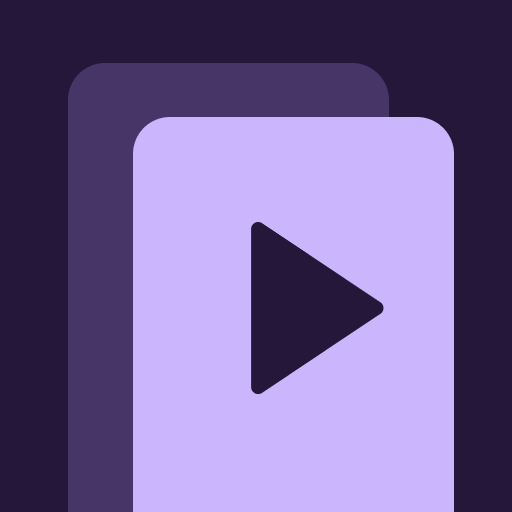
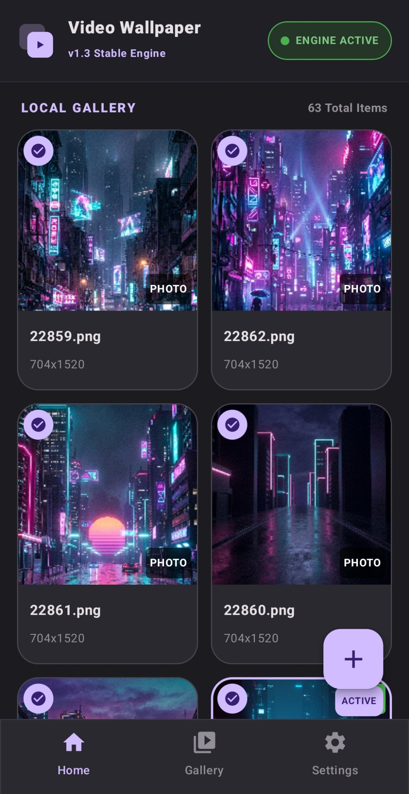
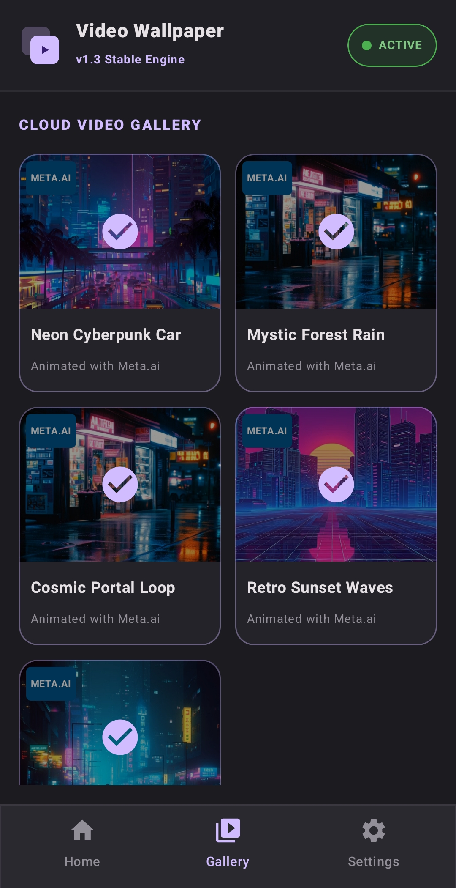
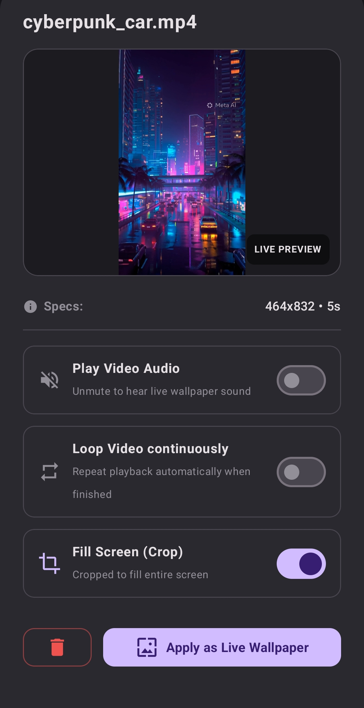
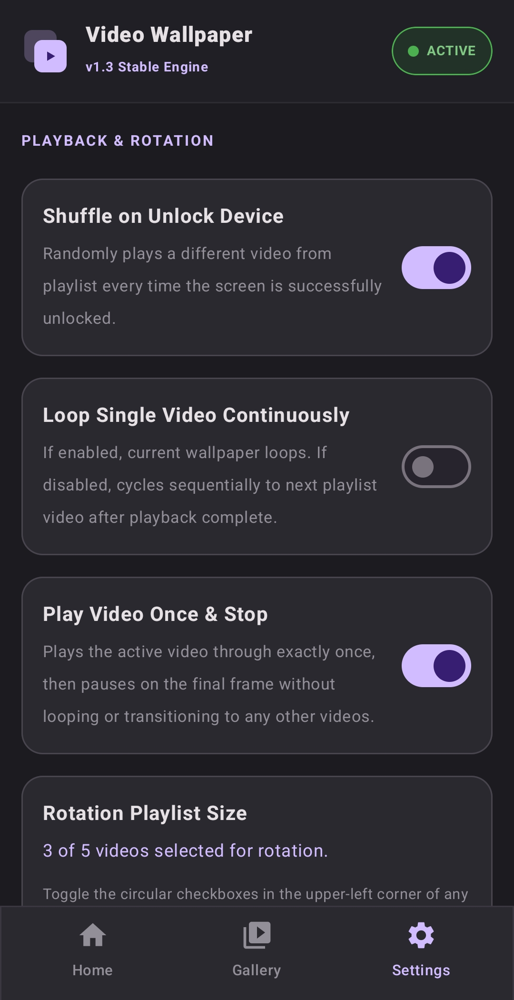
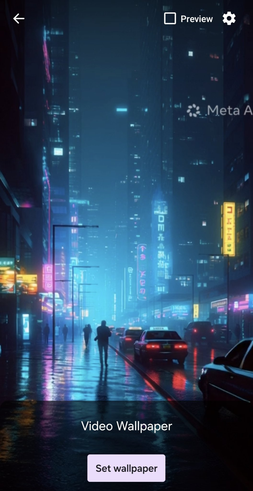
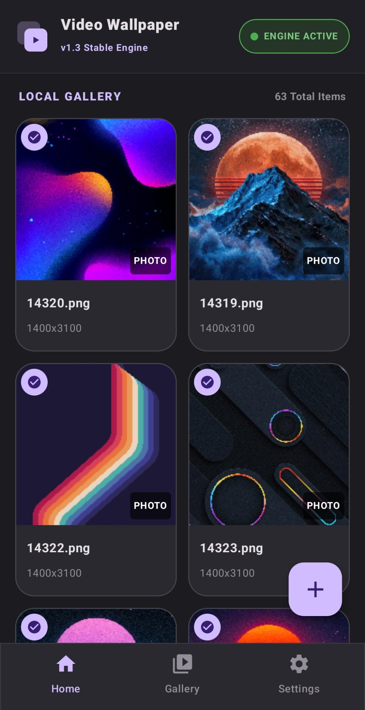
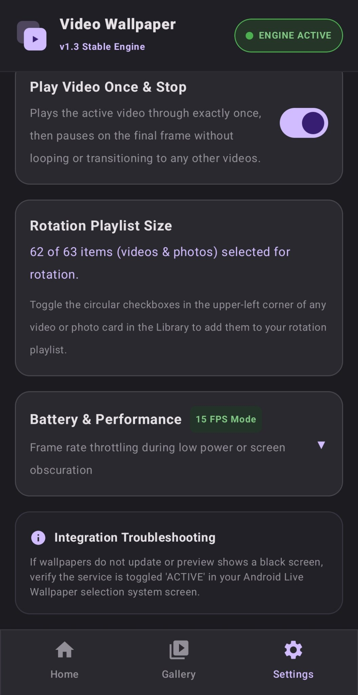

# Video Wallpaper

**Set videos and photos as your live wallpaper — with playlists, shuffle on unlock, and custom fits. Free, no ads.**

Video Wallpaper is a lightweight Android app that turns your own videos and photos — memories, scenic loops, still images, or custom clips — into a rotating live wallpaper for your home and lock screen. It was built because every similar app on the store was stuffed with ads and missing the features that actually matter.

  

## Download

**[⬇ Download the latest APK (v5.3)](https://github.com/icelanderus/Video-Live-Wallpaper-App/releases/latest/download/Video_Wallpaper_v5.3.apk)**

Or browse all versions on the [Releases page](https://github.com/icelanderus/Video-Live-Wallpaper-App/releases).

- Android 7.0 (API 24) or newer
- Install: download the APK, open it, and allow installs from your browser/files app if Android asks

## Features

- **Videos & photos in one rotation** — import videos and still images and let them rotate as a single seamless collection
- **Shuffle on unlock** — a new video or photo from your playlist greets you every time you unlock your phone
- **Loop & sequence control** — each clip can loop forever, play once, or auto-advance to the next
- **Per-video audio** — mute or unmute every video independently
- **Custom fit & scale** — Fit, Crop, Stretch, or Fill, matched to your screen
- **Preset library** — grab pre-optimized looping wallpapers from inside the app
- **Battery smart** — rendering pauses the moment your screen locks or another app is in front
- **Private by design** — your videos stay on your device; no account, no ads, no trackers

## Demo

**[▶ Watch the demo on YouTube](https://www.youtube.com/watch?v=xfYoJHJo970)** · [download the video file](assets/video-wallpaper-demo.mp4)

## Screenshots

  
  
  
  
  
  
  

## Privacy

Your videos never leave your device, and the app collects no personal data. Full details: [PRIVACY_POLICY.md](PRIVACY_POLICY.md).

## Source code

Open source coming soon. This repository is the public download page for the app — releases, screenshots, and documentation live here.

---

Made by [Ilya Tsuprun](https://ilyatsuprun.vercel.app)
